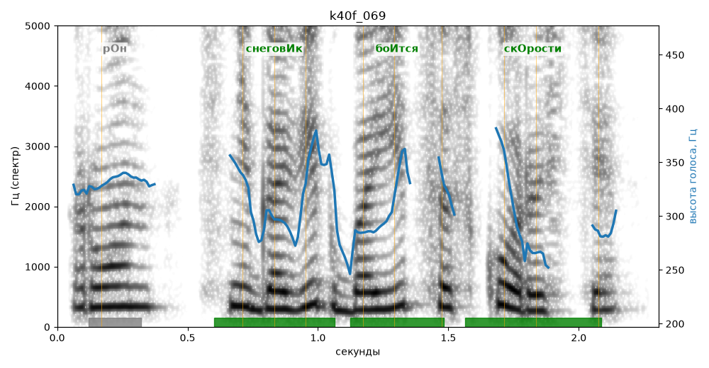

# k40f_069

Эталон: Рон, снеговик боится скорости!
Распознано: Рон с неговик боится скорости.
Расхождения в словах: «снеговик» → «с неговик»

## Ударения
(где нужно: ruaccent)

| слово | нужно | у голоса | |
|---|---|---|---|
| снеговик | снеговИк | снеговИк | ✓ |
| боится | боИтся | боИтся | ✓ |
| скорости | скОрости | скОрости | ✓ |

## Интонация
- ✗ «рон снеговик боится скорости!» — восклицание звучит ровно, без эмоции
- Диапазон голоса 5.4 полутонов (нормально), средняя высота 319 Гц

## Паузы и темп
- паузы на своих местах
- Темп 5.9 слога/с (нормально)

_Синяя линия — высота голоса. Над словами заглавная буква — где ударение должно быть; красным — голос поставил не туда (уверенно), оранжевым — возможно._
