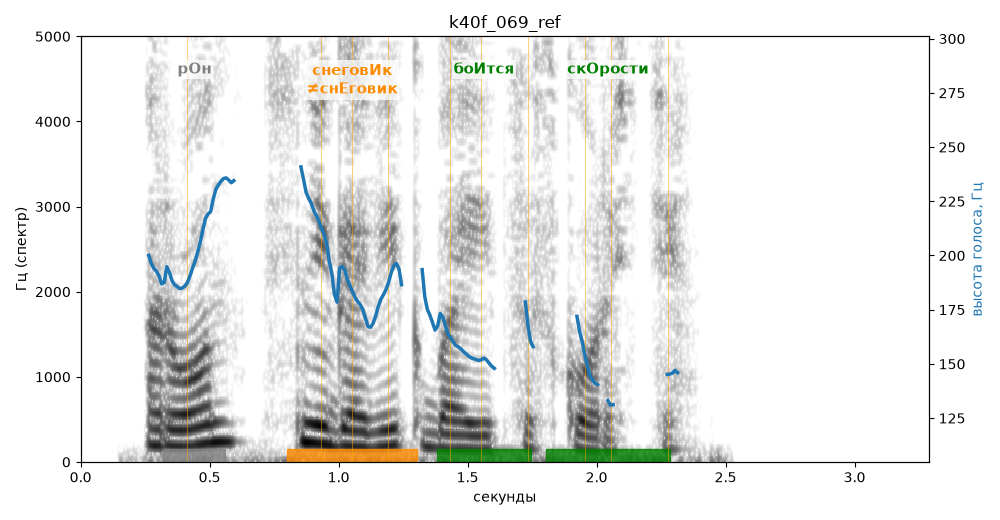

# k40f_069_ref

Голос: **edge:ru-RU-SvetlanaNeural** · длительность 3.3 с
Эталон: Рон, снеговик боится скорости!
Распознано: Рон с неговик боится скорости.
Расхождения в словах: «снеговик» → «с неговик»

## Ударения
(где нужно: ruaccent)

| слово | нужно | у голоса | |
|---|---|---|---|
| снеговик | снеговИк | снЕговик | ✗? возможно — послушать |
| боится | боИтся | боИтся | ✓ |
| скорости | скОрости | скОрости | ✓ |

## Интонация
- ✓ «рон снеговик боится скорости!» — выделено слово «рон» (+2.8 пт)
- Диапазон голоса 8.3 полутонов (живо), средняя высота 182 Гц

## Паузы и темп
- паузы на своих местах
- Темп 5.8 слога/с (нормально)

_Синяя линия — высота голоса. Над словами заглавная буква — где ударение должно быть; красным — голос поставил не туда (уверенно), оранжевым — возможно._
