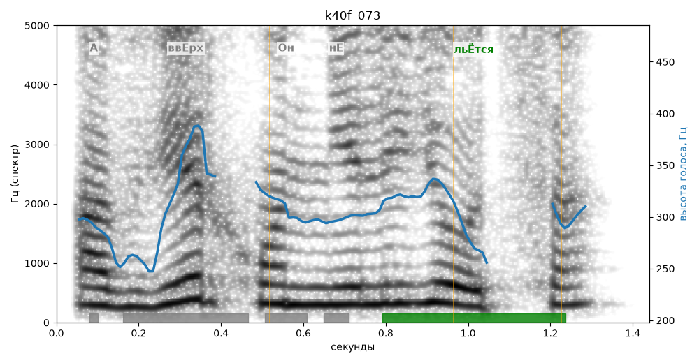

# k40f_073

Эталон: А вверх он не льётся?
Распознано: А вверх он не леется.
Расхождения в словах: «льется» → «леется»

## Ударения
(где нужно: дано в тексте)

| слово | нужно | у голоса | |
|---|---|---|---|
| льётся | льЁтся | льЁтся | ✓ |

## Интонация
- ✗ «а вверх он не льётся?» — нет вопросительного подъёма (самое высокое место — «вверх», в начале) — звучит как утверждение
- Диапазон голоса 5.9 полутонов (нормально), средняя высота 301 Гц

## Паузы и темп
- паузы на своих местах
- Темп 5.2 слога/с (нормально)

_Синяя линия — высота голоса. Над словами заглавная буква — где ударение должно быть; красным — голос поставил не туда (уверенно), оранжевым — возможно._
