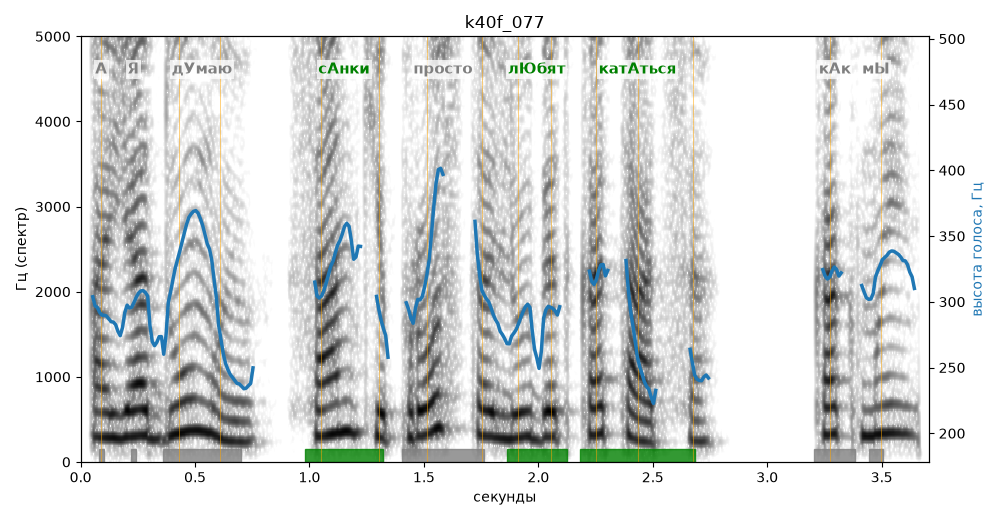

# k40f_077

Эталон: А я думаю, санки просто любят кататься. Как мы!
Распознано: А я думаю, Санки просто любят кататься. Как мы...
Слова: все совпали

## Ударения
(где нужно: ruaccent)

| слово | нужно | у голоса | |
|---|---|---|---|
| думаю | дУмаю | — | ? |
| санки | сАнки | сАнки | ✓ |
| просто | просто | прОсто | нет эталона |
| любят | лЮбят | лЮбят | ✓ |
| кататься | катАться | катАться | ✓ |

## Интонация
- ✓ «а я думаю санки просто любят кататься.» — конец фразы понижается — звучит законченно
- Диапазон голоса 7.2 полутонов (живо), средняя высота 302 Гц

## Паузы и темп
- паузы на своих местах
- Темп 5.3 слога/с (нормально)

_Синяя линия — высота голоса. Над словами заглавная буква — где ударение должно быть; красным — голос поставил не туда (уверенно), оранжевым — возможно._
