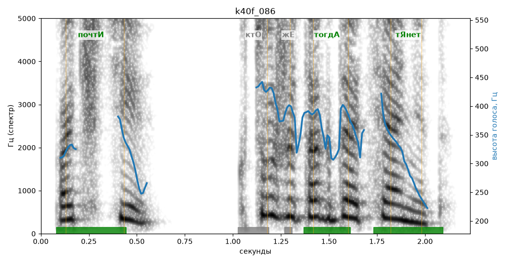

# k40f_086

Эталон: Почти? Кто же тогда тянет?
Распознано: Почти, кто же тогда тянет?
Слова: все совпали

## Ударения
(где нужно: ruaccent)

| слово | нужно | у голоса | |
|---|---|---|---|
| почти | почтИ | почтИ | ✓ |
| тогда | тогдА | тогдА | ✓ |
| тянет | тЯнет | тЯнет | ✓ |

## Интонация
- ✓ «кто же тогда тянет?» — конец фразы понижается — звучит законченно
- Диапазон голоса 9.6 полутонов (живо), средняя высота 346 Гц

## Паузы и темп
- паузы на своих местах
- Темп 5.6 слога/с (нормально)

_Синяя линия — высота голоса. Над словами заглавная буква — где ударение должно быть; красным — голос поставил не туда (уверенно), оранжевым — возможно._
