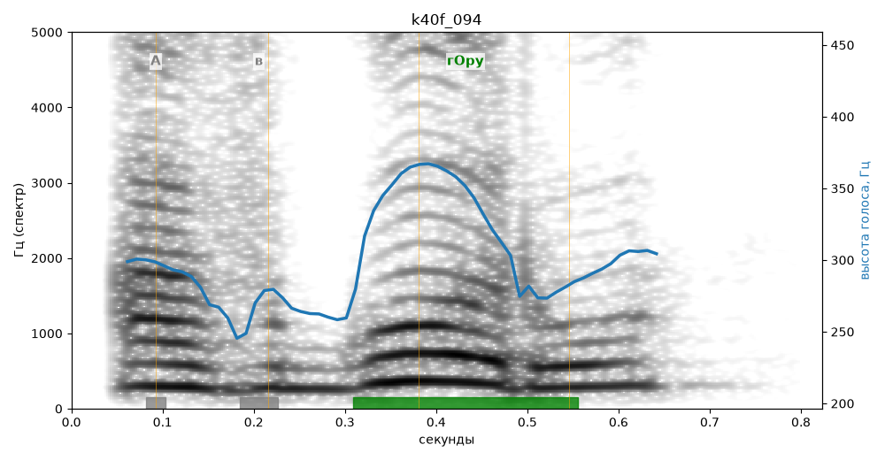

# k40f_094

Эталон: А в гору?
Распознано: Афгору!
Расхождения в словах: «а в гору» → «афгору»

## Ударения
(где нужно: ruaccent)

| слово | нужно | у голоса | |
|---|---|---|---|
| гору | гОру | гОру | ✓ |

## Интонация
- ✓ «а в гору?» — вопросительный подъём на слове «гору»
- Диапазон голоса 5.9 полутонов (нормально), средняя высота 293 Гц

## Паузы и темп
- паузы на своих местах
- Темп 8.5 слога/с (быстро)

_Синяя линия — высота голоса. Над словами заглавная буква — где ударение должно быть; красным — голос поставил не туда (уверенно), оранжевым — возможно._
