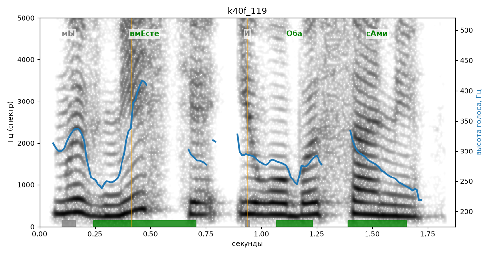

# k40f_119

Эталон: Мы вместе! И оба сами!
Распознано: Мы вместе и его басами.
Расхождения в словах: «оба сами» → «его басами»

## Ударения
(где нужно: ruaccent)

| слово | нужно | у голоса | |
|---|---|---|---|
| вместе | вмЕсте | вмЕсте | ✓ |
| оба | Оба | Оба | ✓ |
| сами | сАми | сАми | ✓ |

## Интонация
- ✗ «мы вместе!» — восклицание звучит ровно, без эмоции
- ✗ «и оба сами!» — восклицание звучит ровно, без эмоции
- Диапазон голоса 7.5 полутонов (живо), средняя высота 283 Гц

## Паузы и темп
- паузы на своих местах
- Темп 6.8 слога/с (быстро)

_Синяя линия — высота голоса. Над словами заглавная буква — где ударение должно быть; красным — голос поставил не туда (уверенно), оранжевым — возможно._
