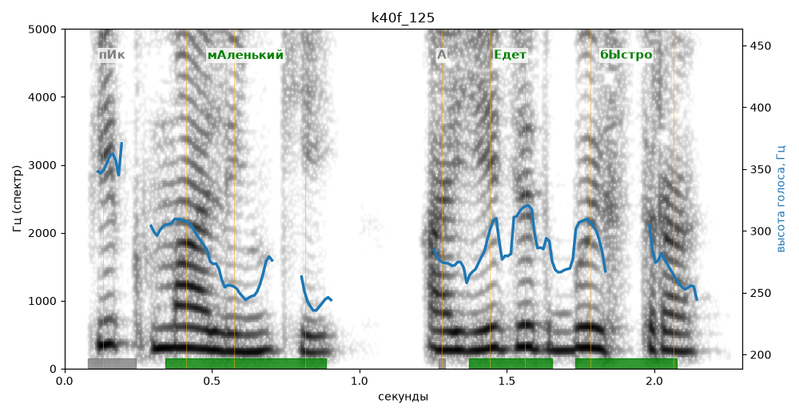

# k40f_125

Эталон: Пик маленький, а едет быстро!
Распознано: Пик маленький, а едет быстро.
Слова: все совпали

## Ударения
(где нужно: ruaccent)

| слово | нужно | у голоса | |
|---|---|---|---|
| маленький | мАленький | мАленький | ✓ |
| едет | Едет | Едет | ✓ |
| быстро | бЫстро | бЫстро | ✓ |

## Интонация
- ✓ «пик маленький а едет быстро!» — выделено слово «пик» (+4.1 пт)
- Диапазон голоса 6.1 полутонов (нормально), средняя высота 277 Гц

## Паузы и темп
- паузы на своих местах
- Темп 5.6 слога/с (нормально)

_Синяя линия — высота голоса. Над словами заглавная буква — где ударение должно быть; красным — голос поставил не туда (уверенно), оранжевым — возможно._
