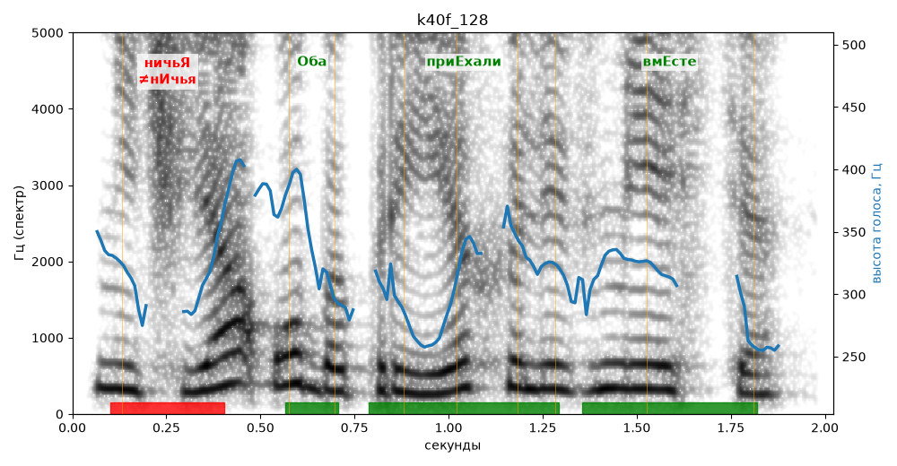

# k40f_128

Эталон: Ничья! Оба приехали вместе!
Распознано: Ничря оба приехали вместе.
Расхождения в словах: «ничья» → «ничря»

## Ударения
(где нужно: ruaccent)

| слово | нужно | у голоса | |
|---|---|---|---|
| ничья | ничьЯ | нИчья | ✗ ОШИБКА |
| оба | Оба | Оба | ✓ |
| приехали | приЕхали | приЕхали | ✓ |
| вместе | вмЕсте | вмЕсте | ✓ |

## Интонация
- ✓ «оба приехали вместе!» — выделено слово «оба» (+3.4 пт)
- Диапазон голоса 7.0 полутонов (живо), средняя высота 319 Гц

## Паузы и темп
- после «ничья!» пауза всего 0.16 с — фразы слипаются
- Темп 5.8 слога/с (нормально)

_Синяя линия — высота голоса. Над словами заглавная буква — где ударение должно быть; красным — голос поставил не туда (уверенно), оранжевым — возможно._
