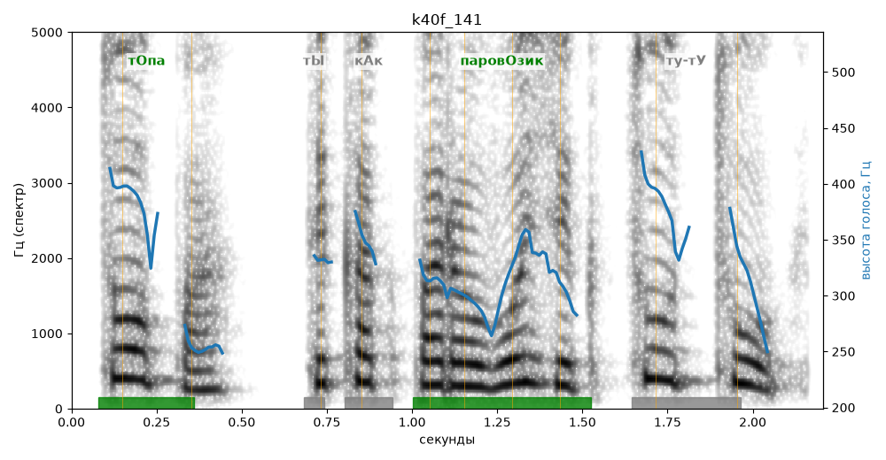

# k40f_141

Эталон: Топа, ты как паровозик! Ту-ту!
Распознано: Топа, ты как поровозик туту!
Расхождения в словах: «паровозик ту-ту» → «поровозик туту»

## Ударения
(где нужно: ruaccent)

| слово | нужно | у голоса | |
|---|---|---|---|
| топа | тОпа | тОпа | ✓ |
| паровозик | паровОзик | паровОзик | ✓ |
| ту-ту | ту-тУ | тУ-ту | ? не разобрать |

## Интонация
- ✓ «топа ты как паровозик!» — выделено слово «топа» (+3.5 пт)
- Диапазон голоса 7.9 полутонов (живо), средняя высота 329 Гц

## Паузы и темп
- после «паровозик!» пауза всего 0.12 с — фразы слипаются
- Темп 6.4 слога/с (нормально)

_Синяя линия — высота голоса. Над словами заглавная буква — где ударение должно быть; красным — голос поставил не туда (уверенно), оранжевым — возможно._
