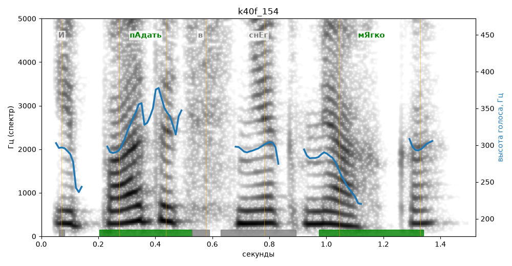

# k40f_154

Эталон: И падать в снег мягко.
Распознано: и падать снег мягко.
Расхождения в словах: «в» → «»

## Ударения
(где нужно: ruaccent)

| слово | нужно | у голоса | |
|---|---|---|---|
| падать | пАдать | пАдать | ✓ |
| мягко | мЯгко | мЯгко | ✓ |

## Интонация
- ✓ «и падать в снег мягко.» — конец фразы понижается — звучит законченно
- Диапазон голоса 7.0 полутонов (живо), средняя высота 296 Гц

## Паузы и темп
- паузы на своих местах
- Темп 5.5 слога/с (нормально)

_Синяя линия — высота голоса. Над словами заглавная буква — где ударение должно быть; красным — голос поставил не туда (уверенно), оранжевым — возможно._
