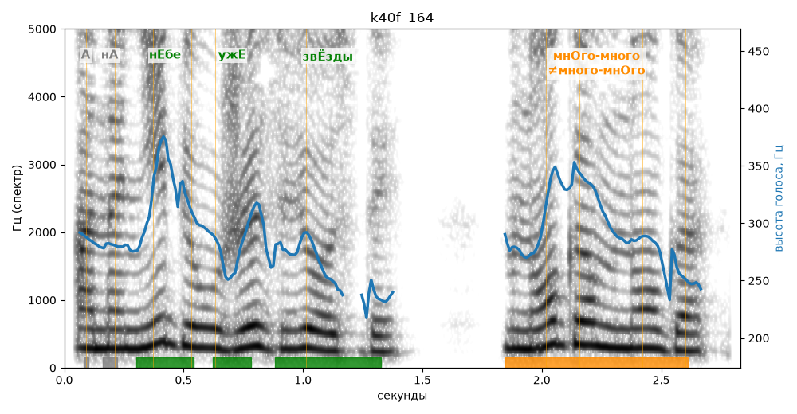

# k40f_164

Эталон: А на небе уже звёзды. Много-много!
Распознано: Она не бил уже звезды. Много-много.
Расхождения в словах: «а на небе» → «она не бил»

## Ударения
(где нужно: ruaccent)

| слово | нужно | у голоса | |
|---|---|---|---|
| небе | нЕбе | нЕбе | ✓ |
| уже | ужЕ | ужЕ | ✓ |
| звёзды | звЁзды | звЁзды | ✓ |
| много-много | мнОго-много | много-мнОго | ✗? возможно — послушать |

## Интонация
- ✓ «а на небе уже звёзды.» — конец фразы понижается — звучит законченно
- ✗ «много-много!» — восклицание звучит ровно, без эмоции
- Диапазон голоса 6.5 полутонов (нормально), средняя высота 283 Гц

## Паузы и темп
- паузы на своих местах
- Темп 6.0 слога/с (нормально)

_Синяя линия — высота голоса. Над словами заглавная буква — где ударение должно быть; красным — голос поставил не туда (уверенно), оранжевым — возможно._
