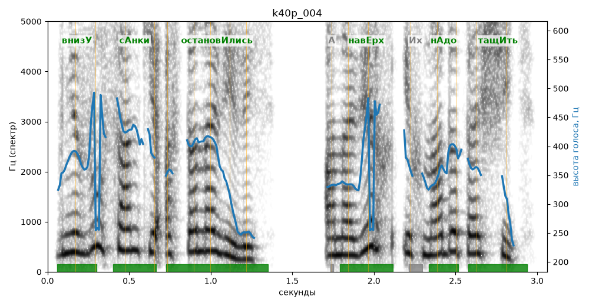

# k40p_004

Эталон: Внизу санки остановились. А наверх их надо тащить.
Распознано: Внизу санки остановились, а наверх их надо подшить.
Расхождения в словах: «тащить» → «подшить»

## Ударения
(где нужно: ruaccent)

| слово | нужно | у голоса | |
|---|---|---|---|
| внизу | внизУ | внизУ | ✓ |
| санки | сАнки | сАнки | ✓ |
| остановились | остановИлись | остановИлись | ✓ |
| наверх | навЕрх | навЕрх | ✓ |
| надо | нАдо | нАдо | ✓ |
| тащить | тащИть | тащИть | ✓ |

## Интонация
- ✓ «внизу санки остановились.» — конец фразы понижается — звучит законченно
- ✓ «а наверх их надо тащить.» — конец фразы понижается — звучит законченно
- Диапазон голоса 10.3 полутонов (живо), средняя высота 362 Гц

## Паузы и темп
- паузы на своих местах
- Темп 6.8 слога/с (быстро)

_Синяя линия — высота голоса. Над словами заглавная буква — где ударение должно быть; красным — голос поставил не туда (уверенно), оранжевым — возможно._
