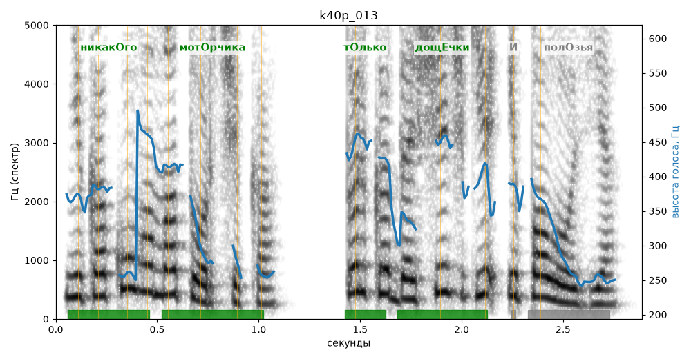

# k40p_013

Эталон: Никакого моторчика. Только дощечки и полозья.
Распознано: никакого моторчика, только десерчики и полозья.
Расхождения в словах: «дощечки» → «десерчики»

## Ударения
(где нужно: ruaccent)

| слово | нужно | у голоса | |
|---|---|---|---|
| никакого | никакОго | никакОго | ✓ |
| моторчика | мотОрчика | мотОрчика | ✓ |
| только | тОлько | тОлько | ✓ |
| дощечки | дощЕчки | дощЕчки | ✓ |
| полозья | полОзья | — | ? |

## Интонация
- ✓ «никакого моторчика.» — конец фразы понижается — звучит законченно
- ✓ «только дощечки и полозья.» — конец фразы понижается — звучит законченно
- Диапазон голоса 10.7 полутонов (живо), средняя высота 367 Гц

## Паузы и темп
- паузы на своих местах
- Темп 7.1 слога/с (быстро)

_Синяя линия — высота голоса. Над словами заглавная буква — где ударение должно быть; красным — голос поставил не туда (уверенно), оранжевым — возможно._
