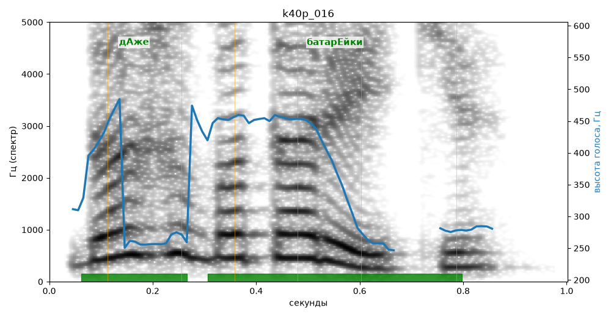

# k40p_016

Эталон: Даже батарейки.
Распознано: Должи батарейки!
Расхождения в словах: «даже» → «должи»

## Ударения
(где нужно: ruaccent)

| слово | нужно | у голоса | |
|---|---|---|---|
| даже | дАже | дАже | ✓ |
| батарейки | батарЕйки | батарЕйки | ✓ |

## Интонация
- ✓ «даже батарейки.» — конец фразы понижается — звучит законченно
- Диапазон голоса 10.1 полутонов (живо), средняя высота 339 Гц

## Паузы и темп
- паузы на своих местах
- Темп 8.2 слога/с (быстро)

_Синяя линия — высота голоса. Над словами заглавная буква — где ударение должно быть; красным — голос поставил не туда (уверенно), оранжевым — возможно._
