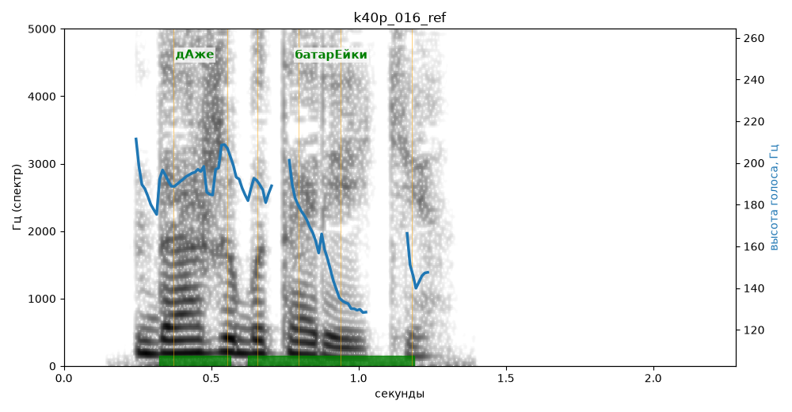

# k40p_016_ref

Голос: **edge:ru-RU-SvetlanaNeural** · длительность 2.3 с
Эталон: Даже батарейки.
Распознано: Даже батарейки.
Слова: все совпали

## Ударения
(где нужно: ruaccent)

| слово | нужно | у голоса | |
|---|---|---|---|
| даже | дАже | дАже | ✓ |
| батарейки | батарЕйки | батарЕйки | ✓ |

## Интонация
- ✓ «даже батарейки.» — конец фразы понижается — звучит законченно
- Диапазон голоса 7.7 полутонов (живо), средняя высота 185 Гц

## Паузы и темп
- паузы на своих местах
- Темп 6.9 слога/с (быстро)

_Синяя линия — высота голоса. Над словами заглавная буква — где ударение должно быть; красным — голос поставил не туда (уверенно), оранжевым — возможно._
