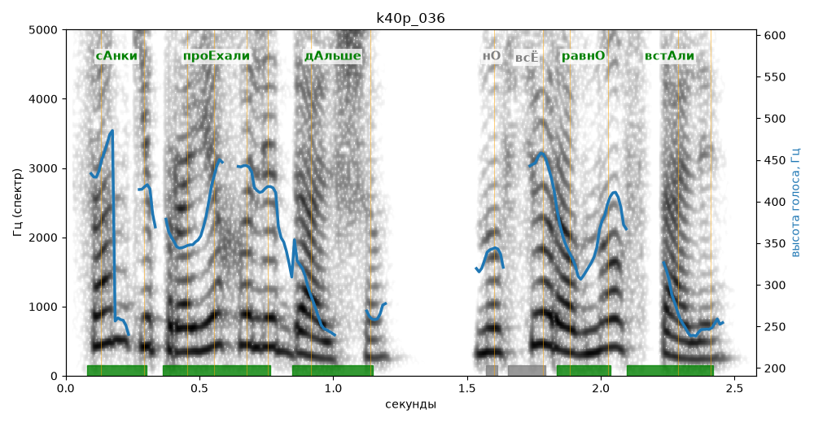

# k40p_036

Эталон: Санки проехали дальше. Но всё равно встали.
Распознано: Санки проехали дальше, но все равно стали.
Расхождения в словах: «встали» → «стали»

## Ударения
(где нужно: ruaccent)

| слово | нужно | у голоса | |
|---|---|---|---|
| санки | сАнки | сАнки | ✓ |
| проехали | проЕхали | проЕхали | ✓ |
| дальше | дАльше | дАльше | ✓ |
| равно | равнО | равнО | ✓ |
| встали | встАли | встАли | ✓ |

## Интонация
- ✓ «санки проехали дальше.» — конец фразы понижается — звучит законченно
- ✓ «но всё равно встали.» — конец фразы понижается — звучит законченно
- Диапазон голоса 10.6 полутонов (живо), средняя высота 345 Гц

## Паузы и темп
- паузы на своих местах
- Темп 7.3 слога/с (быстро)

_Синяя линия — высота голоса. Над словами заглавная буква — где ударение должно быть; красным — голос поставил не туда (уверенно), оранжевым — возможно._
