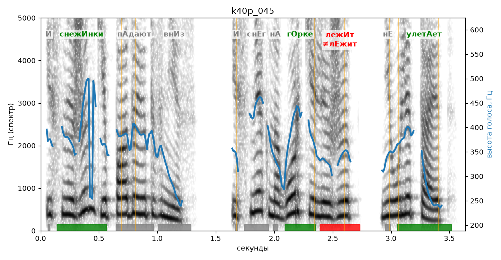

# k40p_045

Эталон: И снежинки падают вниз. И снег на горке лежит, не улетает.
Распознано: И снежинки падают вниз, и снег на горке лежит, не улетает.
Слова: все совпали

## Ударения
(где нужно: ruaccent)

| слово | нужно | у голоса | |
|---|---|---|---|
| снежинки | снежИнки | снежИнки | ✓ |
| падают | пАдают | — | ? |
| горке | гОрке | гОрке | ✓ |
| лежит | лежИт | лЕжит | ✗ ОШИБКА |
| улетает | улетАет | улетАет | ✓ |

## Интонация
- ✓ «и снежинки падают вниз.» — конец фразы понижается — звучит законченно
- ✓ «и снег на горке лежит не улетает.» — конец фразы понижается — звучит законченно
- Диапазон голоса 10.4 полутонов (живо), средняя высота 361 Гц

## Паузы и темп
- паузы на своих местах
- Темп 6.7 слога/с (быстро)

_Синяя линия — высота голоса. Над словами заглавная буква — где ударение должно быть; красным — голос поставил не туда (уверенно), оранжевым — возможно._
