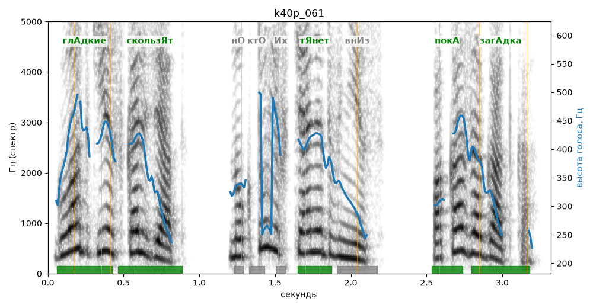

# k40p_061

Эталон: Гладкие скользят. Но кто их тянет вниз? Пока загадка.
Распознано: Глобки из колзят, но кто же в тянет вниз? Пока загадка!
Расхождения в словах: «гладкие скользят» → «глобки из колзят»; «их» → «же в»

## Ударения
(где нужно: ruaccent)

| слово | нужно | у голоса | |
|---|---|---|---|
| гладкие | глАдкие | глАдкие | ✓ |
| скользят | скользЯт | скользЯт | ✓ |
| тянет | тЯнет | тЯнет | ✓ |
| пока | покА | покА | ✓ |
| загадка | загАдка | загАдка | ✓ |

## Интонация
- ✓ «гладкие скользят.» — конец фразы понижается — звучит законченно
- ✓ «но кто их тянет вниз?» — вопросительный подъём на слове «их»
- ✓ «пока загадка.» — конец фразы понижается — звучит законченно
- Диапазон голоса 10.4 полутонов (живо), средняя высота 371 Гц

## Паузы и темп
- паузы на своих местах
- Темп 6.6 слога/с (быстро)

_Синяя линия — высота голоса. Над словами заглавная буква — где ударение должно быть; красным — голос поставил не туда (уверенно), оранжевым — возможно._
