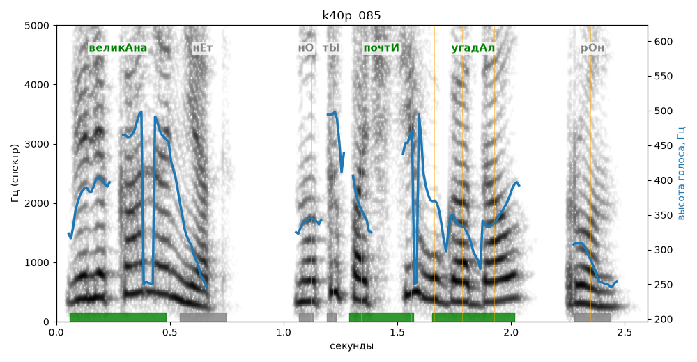

# k40p_085

Эталон: Великана нет. Но ты почти угадал, Рон.
Распознано: Великана нет, но ты почти угадал Рон.
Слова: все совпали

## Ударения
(где нужно: ruaccent)

| слово | нужно | у голоса | |
|---|---|---|---|
| великана | великАна | великАна | ✓ |
| почти | почтИ | почтИ | ✓ |
| угадал | угадАл | угадАл | ✓ |

## Интонация
- ✓ «великана нет.» — конец фразы понижается — звучит законченно
- ✓ «но ты почти угадал рон.» — конец фразы понижается — звучит законченно
- Диапазон голоса 11.5 полутонов (живо), средняя высота 346 Гц

## Паузы и темп
- паузы на своих местах
- Темп 7.2 слога/с (быстро)

_Синяя линия — высота голоса. Над словами заглавная буква — где ударение должно быть; красным — голос поставил не туда (уверенно), оранжевым — возможно._
