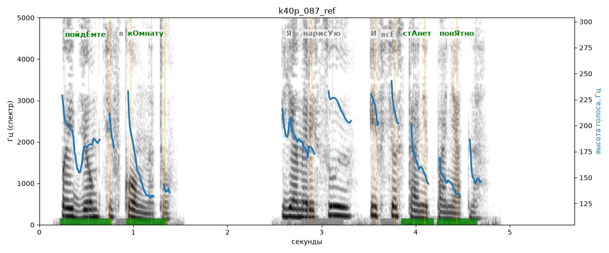

# k40p_087_ref

Голос: **edge:ru-RU-SvetlanaNeural** · длительность 5.7 с
Эталон: Пойдёмте в комнату. Я нарисую, и всё станет понятно.
Распознано: Пойдемте в комнату. Я нарисую, и все станет понятно.
Слова: все совпали

## Ударения
(где нужно: ruaccent)

| слово | нужно | у голоса | |
|---|---|---|---|
| пойдёмте | пойдЁмте | пойдЁмте | ✓ |
| комнату | кОмнату | кОмнату | ✓ |
| нарисую | нарисУю | — | ? |
| станет | стАнет | стАнет | ✓ |
| понятно | понЯтно | понЯтно | ✓ |

## Интонация
- ✗ «пойдёмте в комнату.» — конец фразы не понижается — звучит незаконченно / как перечисление
- ✓ «я нарисую и всё станет понятно.» — конец фразы понижается — звучит законченно
- Диапазон голоса 9.0 полутонов (живо), средняя высота 180 Гц

## Паузы и темп
- паузы на своих местах
- Темп 6.1 слога/с (нормально)

_Синяя линия — высота голоса. Над словами заглавная буква — где ударение должно быть; красным — голос поставил не туда (уверенно), оранжевым — возможно._
