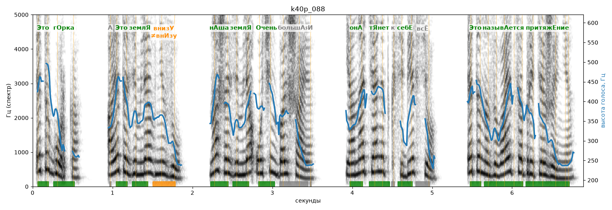

# k40p_088

Эталон: Это горка. А это земля внизу. Наша Земля очень большая. И она тянет к себе всё. Это называется притяжение.
Распознано: Это горка, а это земля внизу. Наша земля очень большая. И она тянет к себе все. Это называется претяжение.
Расхождения в словах: «притяжение» → «претяжение»

## Ударения
(где нужно: ruaccent)

| слово | нужно | у голоса | |
|---|---|---|---|
| это | Это | Это | ✓ |
| горка | гОрка | гОрка | ✓ |
| это | Это | Это | ✓ |
| земля | землЯ | землЯ | ✓ |
| внизу | внизУ | внИзу | ✗? возможно — послушать |
| наша | нАша | нАша | ✓ |
| земля | землЯ | землЯ | ✓ |
| очень | Очень | Очень | ✓ |
| большая | большАя | — | ? |
| она | онА | онА | ✓ |
| тянет | тЯнет | тЯнет | ✓ |
| себе | себЕ | себЕ | ✓ |
| это | Это | Это | ✓ |
| называется | назывАется | назывАется | ✓ |
| притяжение | притяжЕние | притяжЕние | ✓ |

## Интонация
- ✓ «это горка.» — конец фразы понижается — звучит законченно
- ✓ «а это земля внизу.» — конец фразы понижается — звучит законченно
- ✓ «наша земля очень большая.» — конец фразы понижается — звучит законченно
- ✓ «и она тянет к себе всё.» — конец фразы понижается — звучит законченно
- ✓ «это называется притяжение.» — конец фразы понижается — звучит законченно
- Диапазон голоса 11.0 полутонов (живо), средняя высота 359 Гц

## Паузы и темп
- после «большая.» пауза всего 0.02 с — фразы слипаются
- лишняя пауза 0.48 с между «и» и «она»
- Темп 8.4 слога/с (быстро)

_Синяя линия — высота голоса. Над словами заглавная буква — где ударение должно быть; красным — голос поставил не туда (уверенно), оранжевым — возможно._
