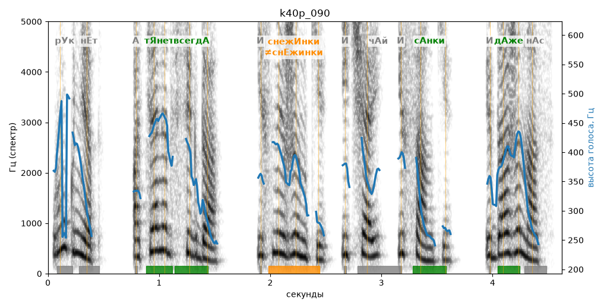

# k40p_090

Эталон: Рук нет. А тянет всегда. И снежинки, и чай, и санки. И даже нас.
Распознано: Угнет, а тянут всегда, и сны жинки, и чай, и санки. И даже нас.
Расхождения в словах: «рук нет» → «угнет»; «тянет» → «тянут»; «снежинки» → «сны жинки»

## Ударения
(где нужно: ruaccent)

| слово | нужно | у голоса | |
|---|---|---|---|
| тянет | тЯнет | тЯнет | ✓ |
| всегда | всегдА | всегдА | ✓ |
| снежинки | снежИнки | снЕжинки | ✗? возможно — послушать |
| санки | сАнки | сАнки | ✓ |
| даже | дАже | дАже | ✓ |

## Интонация
- ✓ «а тянет всегда.» — конец фразы понижается — звучит законченно
- ✓ «и снежинки и чай и санки.» — конец фразы понижается — звучит законченно
- ✓ «и даже нас.» — конец фразы понижается — звучит законченно
- Диапазон голоса 10.1 полутонов (живо), средняя высота 358 Гц

## Паузы и темп
- после «чай,» нет паузы (0.00 с)
- Темп 6.6 слога/с (быстро)

_Синяя линия — высота голоса. Над словами заглавная буква — где ударение должно быть; красным — голос поставил не туда (уверенно), оранжевым — возможно._
