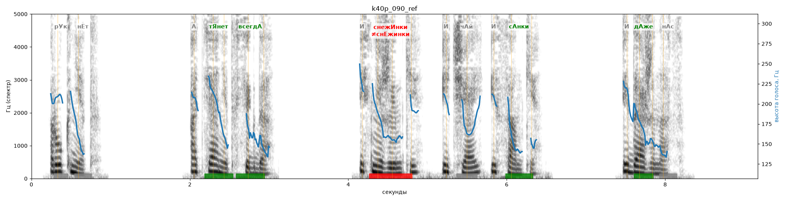

# k40p_090_ref

Голос: **edge:ru-RU-SvetlanaNeural** · длительность 9.2 с
Эталон: Рук нет. А тянет всегда. И снежинки, и чай, и санки. И даже нас.
Распознано: Рук нет. Отянет всегда. И снижинки, и чай, и санки. И даже нас.
Расхождения в словах: «а тянет» → «отянет»; «снежинки» → «снижинки»

## Ударения
(где нужно: ruaccent)

| слово | нужно | у голоса | |
|---|---|---|---|
| тянет | тЯнет | тЯнет | ✓ |
| всегда | всегдА | всегдА | ✓ |
| снежинки | снежИнки | снЕжинки | ✗ ОШИБКА |
| санки | сАнки | сАнки | ✓ |
| даже | дАже | дАже | ✓ |

## Интонация
- ✓ «а тянет всегда.» — конец фразы понижается — звучит законченно
- ✓ «и снежинки и чай и санки.» — конец фразы понижается — звучит законченно
- ✓ «и даже нас.» — конец фразы понижается — звучит законченно
- Диапазон голоса 7.8 полутонов (живо), средняя высота 171 Гц

## Паузы и темп
- паузы на своих местах
- Темп 5.6 слога/с (нормально)

_Синяя линия — высота голоса. Над словами заглавная буква — где ударение должно быть; красным — голос поставил не туда (уверенно), оранжевым — возможно._
