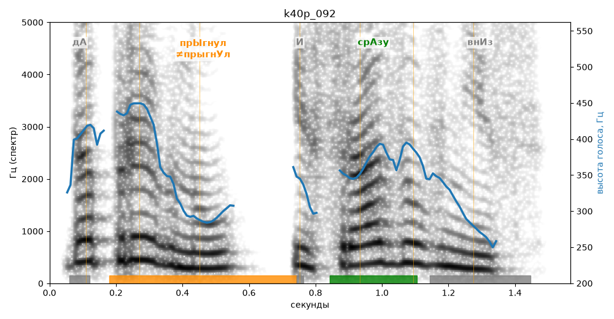

# k40p_092

Эталон: Да! Прыгнул — и сразу вниз.
Распознано: Допрыгну и сразу вниз.
Расхождения в словах: «да прыгнул» → «допрыгну»

## Ударения
(где нужно: ruaccent)

| слово | нужно | у голоса | |
|---|---|---|---|
| прыгнул | прЫгнул | прыгнУл | ✗? возможно — послушать |
| сразу | срАзу | срАзу | ✓ |

## Интонация
- ✓ «прыгнул и сразу вниз.» — конец фразы понижается — звучит законченно
- Диапазон голоса 8.4 полутонов (живо), средняя высота 348 Гц

## Паузы и темп
- после «да!» пауза всего 0.06 с — фразы слипаются
- после «прыгнул—» нет паузы (0.00 с)
- Темп 5.1 слога/с (нормально)

_Синяя линия — высота голоса. Над словами заглавная буква — где ударение должно быть; красным — голос поставил не туда (уверенно), оранжевым — возможно._
