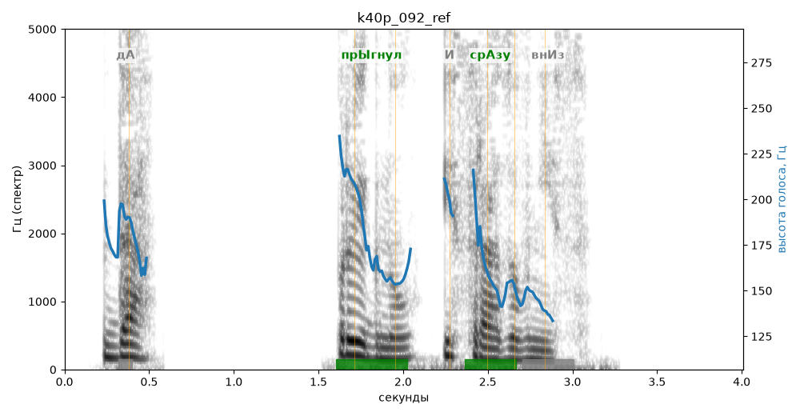

# k40p_092_ref

Голос: **edge:ru-RU-SvetlanaNeural** · длительность 4.0 с
Эталон: Да! Прыгнул — и сразу вниз.
Распознано: Да. Прыгнул и сразу вниз.
Слова: все совпали

## Ударения
(где нужно: ruaccent)

| слово | нужно | у голоса | |
|---|---|---|---|
| прыгнул | прЫгнул | прЫгнул | ✓ |
| сразу | срАзу | срАзу | ✓ |

## Интонация
- ✓ «прыгнул и сразу вниз.» — конец фразы понижается — звучит законченно
- Диапазон голоса 7.3 полутонов (живо), средняя высота 162 Гц

## Паузы и темп
- паузы на своих местах
- Темп 5.6 слога/с (нормально)

_Синяя линия — высота голоса. Над словами заглавная буква — где ударение должно быть; красным — голос поставил не туда (уверенно), оранжевым — возможно._
