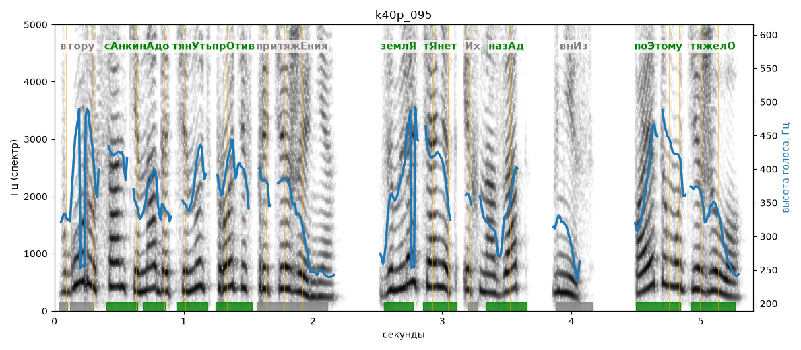

# k40p_095

Эталон: В гору санки надо тянуть против притяжения. Земля тянет их назад, вниз. Поэтому тяжело.
Распознано: В гору санки надо тянуть против претяжения. Замлятянет их назад, вниз. Поэтому тяжело.
Расхождения в словах: «притяжения земля тянет» → «претяжения замлятянет»

## Ударения
(где нужно: ruaccent)

| слово | нужно | у голоса | |
|---|---|---|---|
| гору | гору | гОру | нет эталона |
| санки | сАнки | сАнки | ✓ |
| надо | нАдо | нАдо | ✓ |
| тянуть | тянУть | тянУть | ✓ |
| против | прОтив | прОтив | ✓ |
| притяжения | притяжЕния | — | ? |
| земля | землЯ | землЯ | ✓ |
| тянет | тЯнет | тЯнет | ✓ |
| назад | назАд | назАд | ✓ |
| поэтому | поЭтому | поЭтому | ✓ |
| тяжело | тяжелО | тяжелО | ✓ |

## Интонация
- ✓ «в гору санки надо тянуть против притяжения.» — конец фразы понижается — звучит законченно
- ✓ «земля тянет их назад вниз.» — конец фразы понижается — звучит законченно
- ✓ «поэтому тяжело.» — конец фразы понижается — звучит законченно
- Диапазон голоса 10.7 полутонов (живо), средняя высота 358 Гц

## Паузы и темп
- паузы на своих местах
- Темп 7.1 слога/с (быстро)

_Синяя линия — высота голоса. Над словами заглавная буква — где ударение должно быть; красным — голос поставил не туда (уверенно), оранжевым — возможно._
