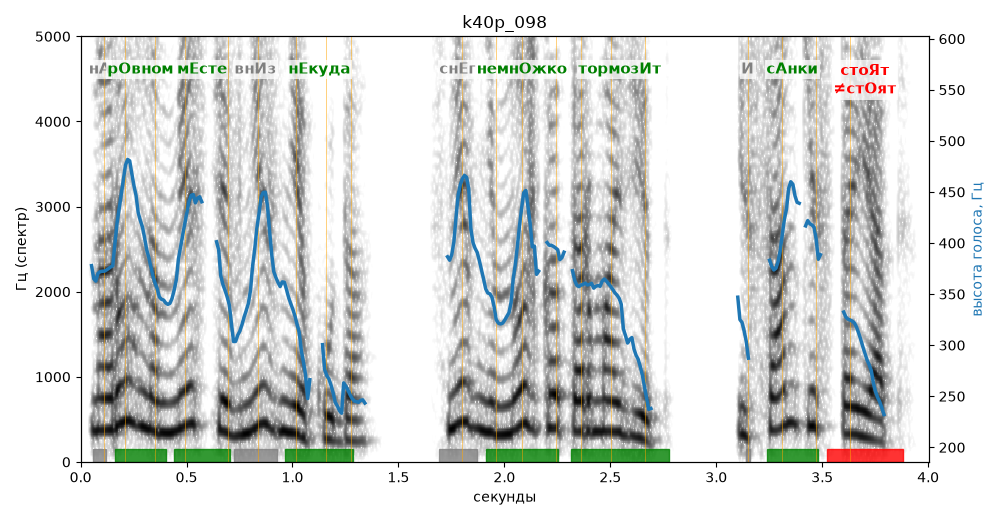

# k40p_098

Эталон: На ровном месте вниз некуда. Снег немножко тормозит. И санки стоят.
Распознано: Нару на месте вниз некуда. Снег немного тормозит. И санки стоят.
Расхождения в словах: «» → «нару»; «ровном» → «»; «немножко» → «немного»

## Ударения
(где нужно: ruaccent)

| слово | нужно | у голоса | |
|---|---|---|---|
| ровном | рОвном | рОвном | ✓ |
| месте | мЕсте | мЕсте | ✓ |
| некуда | нЕкуда | нЕкуда | ✓ |
| немножко | немнОжко | немнОжко | ✓ |
| тормозит | тормозИт | тормозИт | ✓ |
| санки | сАнки | сАнки | ✓ |
| стоят | стоЯт | стОят | ✗ ОШИБКА |

## Интонация
- ✓ «на ровном месте вниз некуда.» — конец фразы понижается — звучит законченно
- ✓ «снег немножко тормозит.» — конец фразы понижается — звучит законченно
- ✗ «и санки стоят.» — конец фразы не понижается — звучит незаконченно / как перечисление
- Диапазон голоса 10.6 полутонов (живо), средняя высота 361 Гц

## Паузы и темп
- паузы на своих местах
- Темп 6.5 слога/с (нормально)

_Синяя линия — высота голоса. Над словами заглавная буква — где ударение должно быть; красным — голос поставил не туда (уверенно), оранжевым — возможно._
