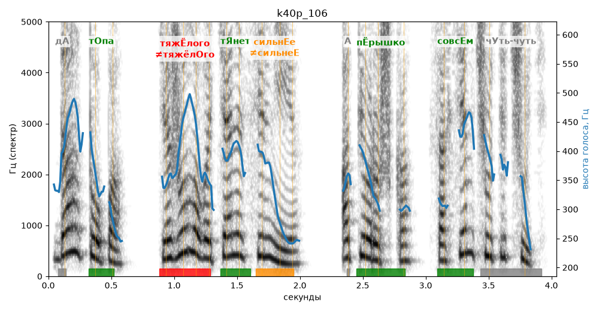

# k40p_106

Эталон: Да, Топа. Тяжёлого тянет сильнее. А пёрышко — совсем чуть-чуть.
Распознано: Да, Топа, тяжелого тянет сильнее, а пёрышка совсем чуть-чуть.
Расхождения в словах: «перышко» → «перышка»

## Ударения
(где нужно: ruaccent)

| слово | нужно | у голоса | |
|---|---|---|---|
| топа | тОпа | тОпа | ✓ |
| тяжёлого | тяжЁлого | тяжёлОго | ✗ ОШИБКА |
| тянет | тЯнет | тЯнет | ✓ |
| сильнее | сильнЕе | сильнеЕ | ✗? возможно — послушать |
| пёрышко | пЁрышко | пЁрышко | ✓ |
| совсем | совсЕм | совсЕм | ✓ |
| чуть-чуть | чУть-чуть | чуть-чУть | ? не разобрать |

## Интонация
- ✗ «да топа.» — конец фразы не понижается — звучит незаконченно / как перечисление
- ✓ «тяжёлого тянет сильнее.» — конец фразы понижается — звучит законченно
- ✗ «а пёрышко совсем чуть-чуть.» — конец фразы не понижается — звучит незаконченно / как перечисление
- Диапазон голоса 11.3 полутонов (живо), средняя высота 360 Гц

## Паузы и темп
- паузы на своих местах
- Темп 7.7 слога/с (быстро)

_Синяя линия — высота голоса. Над словами заглавная буква — где ударение должно быть; красным — голос поставил не туда (уверенно), оранжевым — возможно._
