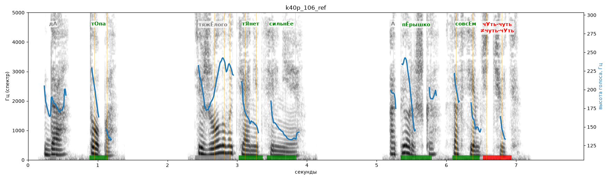

# k40p_106_ref

Голос: **edge:ru-RU-SvetlanaNeural** · длительность 8.0 с
Эталон: Да, Топа. Тяжёлого тянет сильнее. А пёрышко — совсем чуть-чуть.
Распознано: Да, топа. Тяжелого тянет сильнее. Оперышка совсем чуть-чуть.
Расхождения в словах: «а перышко» → «оперышка»

## Ударения
(где нужно: ruaccent)

| слово | нужно | у голоса | |
|---|---|---|---|
| топа | тОпа | тОпа | ✓ |
| тяжёлого | тяжЁлого | тяжёлогО | ? не разобрать |
| тянет | тЯнет | тЯнет | ✓ |
| сильнее | сильнЕе | сильнЕе | ✓ |
| пёрышко | пЁрышко | пЁрышко | ✓ |
| совсем | совсЕм | совсЕм | ✓ |
| чуть-чуть | чУть-чуть | чуть-чУть | ✗ ОШИБКА |

## Интонация
- ✗ «да топа.» — конец фразы не понижается — звучит незаконченно / как перечисление
- ✓ «тяжёлого тянет сильнее.» — конец фразы понижается — звучит законченно
- ✓ «а пёрышко совсем чуть-чуть.» — конец фразы понижается — звучит законченно
- Диапазон голоса 9.8 полутонов (живо), средняя высота 177 Гц

## Паузы и темп
- паузы на своих местах
- Темп 6.3 слога/с (нормально)

_Синяя линия — высота голоса. Над словами заглавная буква — где ударение должно быть; красным — голос поставил не туда (уверенно), оранжевым — возможно._
