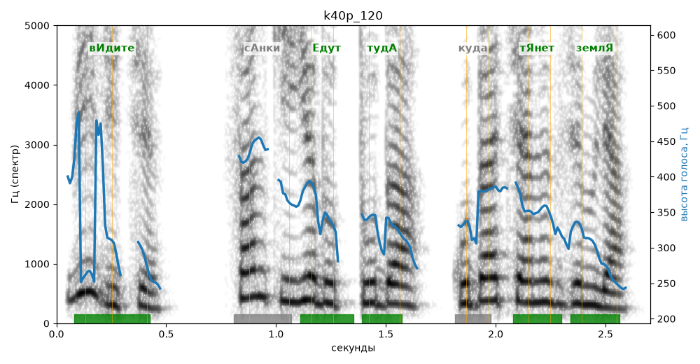

# k40p_120

Эталон: Видите? Санки едут туда, куда тянет Земля.
Распознано: ельdir
Расхождения в словах: «видите санки едут туда куда тянет земля» → «ель»

## Ударения
(где нужно: ruaccent)

| слово | нужно | у голоса | |
|---|---|---|---|
| видите | вИдите | вИдите | ✓ |
| санки | сАнки | санкИ | ? не разобрать |
| едут | Едут | Едут | ✓ |
| туда | тудА | тудА | ✓ |
| куда | куда | кудА | нет эталона |
| тянет | тЯнет | тЯнет | ✓ |
| земля | землЯ | землЯ | ✓ |

## Интонация
- ✗ «видите?» — нет вопросительного подъёма (самое высокое место — «видите», в начале) — звучит как утверждение
- ✓ «санки едут туда куда тянет земля.» — конец фразы понижается — звучит законченно
- Диапазон голоса 9.9 полутонов (живо), средняя высота 337 Гц

## Паузы и темп
- паузы на своих местах
- Темп 8.1 слога/с (быстро)

_Синяя линия — высота голоса. Над словами заглавная буква — где ударение должно быть; красным — голос поставил не туда (уверенно), оранжевым — возможно._
