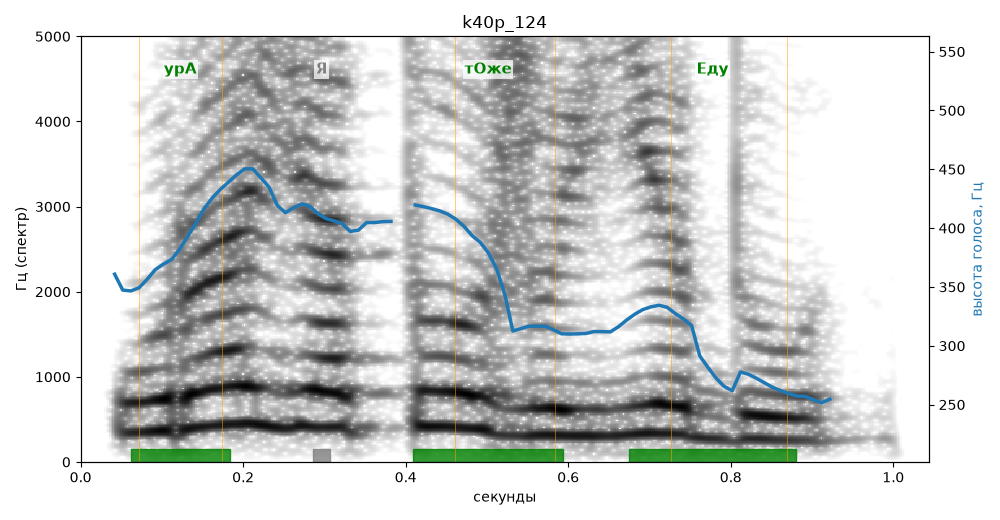

# k40p_124

Эталон: Ура! Я тоже еду!
Распознано: Ура я тоже еду.
Слова: все совпали

## Ударения
(где нужно: ruaccent)

| слово | нужно | у голоса | |
|---|---|---|---|
| ура | урА | урА | ✓ |
| тоже | тОже | тОже | ✓ |
| еду | Еду | Еду | ✓ |

## Интонация
- ✓ «я тоже еду!» — выделено слово «тоже» (+4.2 пт)
- Диапазон голоса 9.2 полутонов (живо), средняя высота 349 Гц

## Паузы и темп
- после «ура!» пауза всего 0.10 с — фразы слипаются
- Темп 7.3 слога/с (быстро)

_Синяя линия — высота голоса. Над словами заглавная буква — где ударение должно быть; красным — голос поставил не туда (уверенно), оранжевым — возможно._
