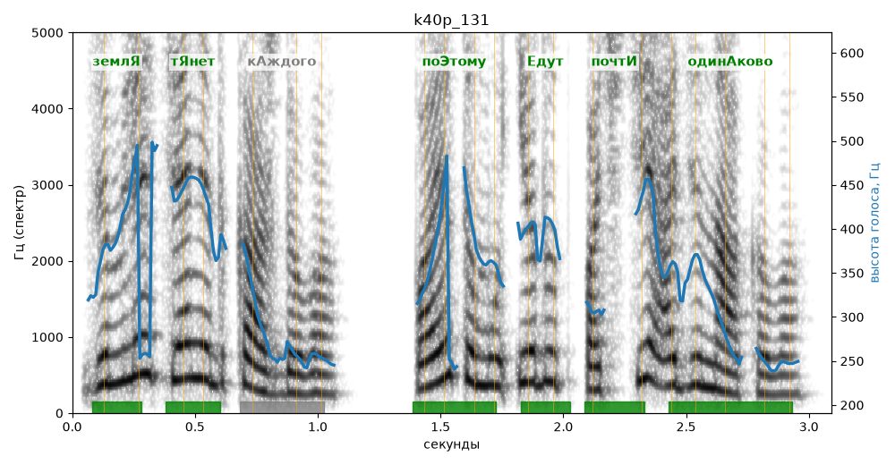

# k40p_131

Эталон: Земля тянет каждого. Поэтому едут почти одинаково.
Распознано: Замлятья не до каждого, поэтому идут почти одинаково.
Расхождения в словах: «земля тянет» → «замлятья не до»; «едут» → «идут»

## Ударения
(где нужно: ruaccent)

| слово | нужно | у голоса | |
|---|---|---|---|
| земля | землЯ | землЯ | ✓ |
| тянет | тЯнет | тЯнет | ✓ |
| каждого | кАждого | каждОго | ? не разобрать |
| поэтому | поЭтому | поЭтому | ✓ |
| едут | Едут | Едут | ✓ |
| почти | почтИ | почтИ | ✓ |
| одинаково | одинАково | одинАково | ✓ |

## Интонация
- ✓ «земля тянет каждого.» — конец фразы понижается — звучит законченно
- ✓ «поэтому едут почти одинаково.» — конец фразы понижается — звучит законченно
- Диапазон голоса 10.7 полутонов (живо), средняя высота 351 Гц

## Паузы и темп
- паузы на своих местах
- Темп 8.0 слога/с (быстро)

_Синяя линия — высота голоса. Над словами заглавная буква — где ударение должно быть; красным — голос поставил не туда (уверенно), оранжевым — возможно._
