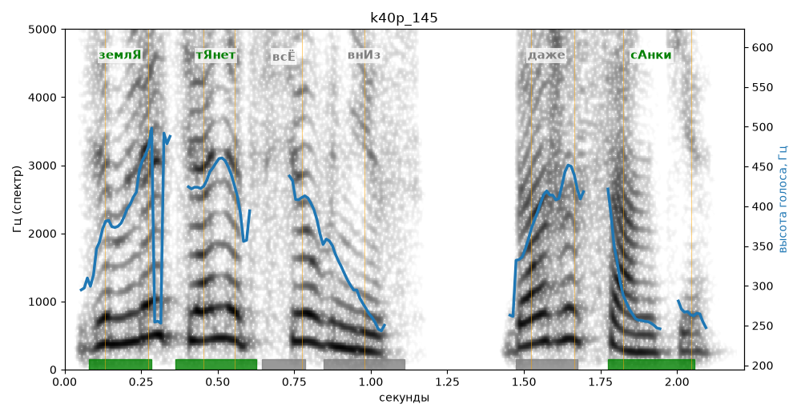

# k40p_145

Эталон: Земля тянет всё вниз. Даже санки.
Распознано: Земля тянет всё вниз. Даже санки.
Слова: все совпали

## Ударения
(где нужно: ruaccent)

| слово | нужно | у голоса | |
|---|---|---|---|
| земля | землЯ | землЯ | ✓ |
| тянет | тЯнет | тЯнет | ✓ |
| даже | даже | дАже | нет эталона |
| санки | сАнки | сАнки | ✓ |

## Интонация
- ✓ «земля тянет всё вниз.» — конец фразы понижается — звучит законченно
- ✓ «даже санки.» — конец фразы понижается — звучит законченно
- Диапазон голоса 10.4 полутонов (живо), средняя высота 372 Гц

## Паузы и темп
- паузы на своих местах
- Темп 6.2 слога/с (нормально)

_Синяя линия — высота голоса. Над словами заглавная буква — где ударение должно быть; красным — голос поставил не туда (уверенно), оранжевым — возможно._
