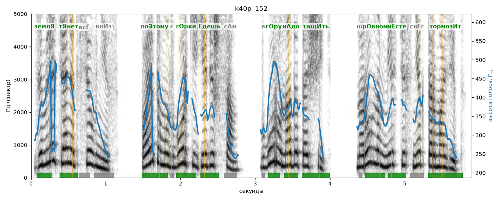

# k40p_152

Эталон: Земля тянет всё вниз. Поэтому с горки едешь сам. В гору надо тащить. На ровном месте снег тормозит.
Распознано: Земля тянет все вниз, поэтому с горки едешь сам. В гору надо тасшить, на ровном месте снег тормозит.
Расхождения в словах: «тащить» → «тасшить»

## Ударения
(где нужно: ruaccent)

| слово | нужно | у голоса | |
|---|---|---|---|
| земля | землЯ | землЯ | ✓ |
| тянет | тЯнет | тЯнет | ✓ |
| поэтому | поЭтому | поЭтому | ✓ |
| горки | гОрки | гОрки | ✓ |
| едешь | Едешь | Едешь | ✓ |
| гору | гОру | гОру | ✓ |
| надо | нАдо | нАдо | ✓ |
| тащить | тащИть | тащИть | ✓ |
| ровном | рОвном | рОвном | ✓ |
| месте | мЕсте | мЕсте | ✓ |
| тормозит | тормозИт | тормозИт | ✓ |

## Интонация
- ✓ «земля тянет всё вниз.» — конец фразы понижается — звучит законченно
- ✓ «поэтому с горки едешь сам.» — конец фразы понижается — звучит законченно
- ✓ «в гору надо тащить.» — конец фразы понижается — звучит законченно
- ✓ «на ровном месте снег тормозит.» — конец фразы понижается — звучит законченно
- Диапазон голоса 10.5 полутонов (живо), средняя высота 360 Гц

## Паузы и темп
- паузы на своих местах
- Темп 7.0 слога/с (быстро)

_Синяя линия — высота голоса. Над словами заглавная буква — где ударение должно быть; красным — голос поставил не туда (уверенно), оранжевым — возможно._
