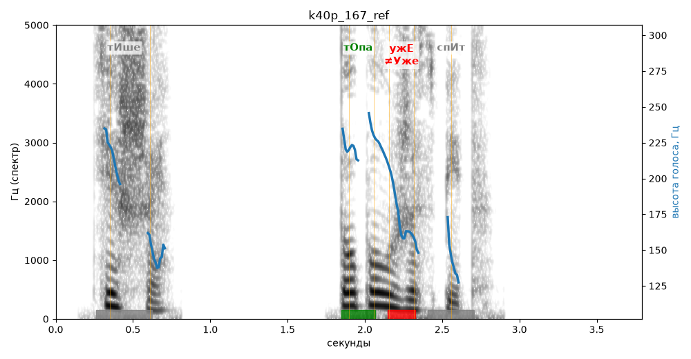

# k40p_167_ref

Голос: **edge:ru-RU-SvetlanaNeural** · длительность 3.8 с
Эталон: Т+ише. Топа уж+е спит.
Распознано: Теши. Топа уже спит.
Расхождения в словах: «тише» → «теши»

## Ударения
(где нужно: ruaccent)

| слово | нужно | у голоса | |
|---|---|---|---|
| тише | тИше | тишЕ | ? не разобрать |
| топа | тОпа | тОпа | ✓ |
| уже | ужЕ | Уже | ✗ ОШИБКА |

## Интонация
- ✓ «топа уже спит.» — конец фразы понижается — звучит законченно
- Диапазон голоса 9.2 полутонов (живо), средняя высота 196 Гц

## Паузы и темп
- паузы на своих местах
- Темп 5.7 слога/с (нормально)

_Синяя линия — высота голоса. Над словами заглавная буква — где ударение должно быть; красным — голос поставил не туда (уверенно), оранжевым — возможно._
