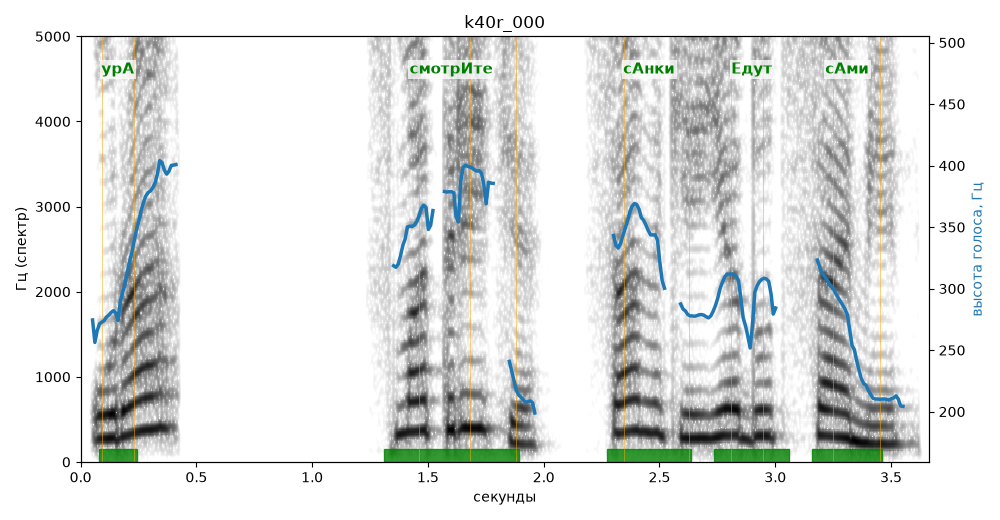

# k40r_000

Эталон: Ура! Смотрите, санки едут сами!
Распознано: Ура? Смотрите, санки едут сами.
Слова: все совпали

## Ударения
(где нужно: ruaccent)

| слово | нужно | у голоса | |
|---|---|---|---|
| ура | урА | урА | ✓ |
| смотрите | смотрИте | смотрИте | ✓ |
| санки | сАнки | сАнки | ✓ |
| едут | Едут | Едут | ✓ |
| сами | сАми | сАми | ✓ |

## Интонация
- ✓ «смотрите санки едут сами!» — выделено слово «смотрите» (+4.5 пт)
- Диапазон голоса 11.0 полутонов (живо), средняя высота 308 Гц

## Паузы и темп
- паузы на своих местах
- Темп 5.7 слога/с (нормально)

_Синяя линия — высота голоса. Над словами заглавная буква — где ударение должно быть; красным — голос поставил не туда (уверенно), оранжевым — возможно._
