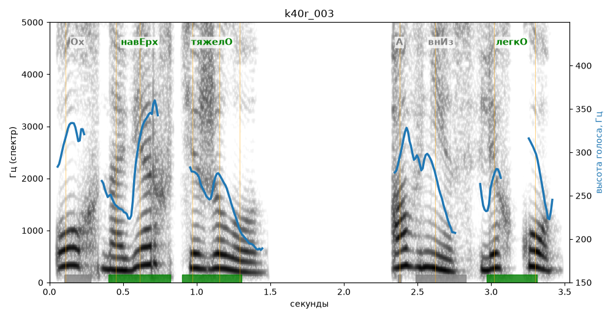

# k40r_003

Эталон: Ох, наверх тяжело! А вниз — легко!
Распознано: Ох, наверх тяжело. А вниз, легко.
Слова: все совпали

## Ударения
(где нужно: ruaccent)

| слово | нужно | у голоса | |
|---|---|---|---|
| наверх | навЕрх | навЕрх | ✓ |
| тяжело | тяжелО | тяжелО | ✓ |
| легко | легкО | легкО | ✓ |

## Интонация
- ✓ «ох наверх тяжело!» — выделено слово «наверх» (+3.5 пт)
- ✗ «а вниз легко!» — восклицание звучит ровно, без эмоции
- Диапазон голоса 9.4 полутонов (живо), средняя высота 269 Гц

## Паузы и темп
- паузы на своих местах
- Темп 4.7 слога/с (нормально)

_Синяя линия — высота голоса. Над словами заглавная буква — где ударение должно быть; красным — голос поставил не туда (уверенно), оранжевым — возможно._
