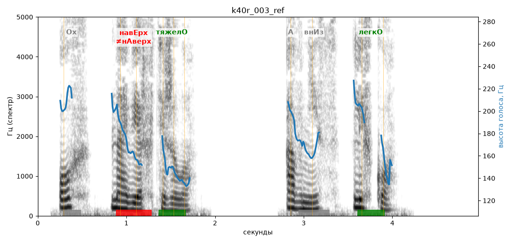

# k40r_003_ref

Голос: **edge:ru-RU-SvetlanaNeural** · длительность 5.0 с
Эталон: Ох, наверх тяжело! А вниз — легко!
Распознано: Ох, наверх тяжело. А вниз, легко.
Слова: все совпали

## Ударения
(где нужно: ruaccent)

| слово | нужно | у голоса | |
|---|---|---|---|
| наверх | навЕрх | нАверх | ✗ ОШИБКА |
| тяжело | тяжелО | тяжелО | ✓ |
| легко | легкО | легкО | ✓ |

## Интонация
- ✓ «ох наверх тяжело!» — выделено слово «ох» (+4.8 пт)
- ✗ «а вниз легко!» — восклицание звучит ровно, без эмоции
- Диапазон голоса 8.0 полутонов (живо), средняя высота 168 Гц

## Паузы и темп
- паузы на своих местах
- Темп 5.8 слога/с (нормально)

_Синяя линия — высота голоса. Над словами заглавная буква — где ударение должно быть; красным — голос поставил не туда (уверенно), оранжевым — возможно._
