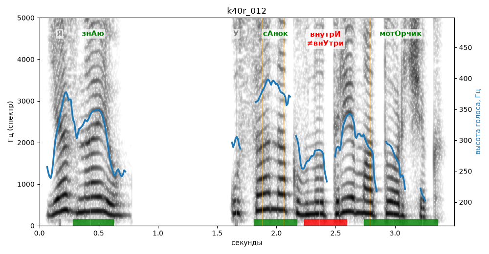

# k40r_012

Эталон: Я знаю! У санок внутри моторчик!
Распознано: Я знаю. У Санак внутри моторчик.
Расхождения в словах: «санок» → «санак»

## Ударения
(где нужно: ruaccent)

| слово | нужно | у голоса | |
|---|---|---|---|
| знаю | знАю | знАю | ✓ |
| санок | сАнок | сАнок | ✓ |
| внутри | внутрИ | внУтри | ✗ ОШИБКА |
| моторчик | мотОрчик | мотОрчик | ✓ |

## Интонация
- ✓ «у санок внутри моторчик!» — выделено слово «санок» (+4.7 пт)
- Диапазон голоса 8.6 полутонов (живо), средняя высота 303 Гц

## Паузы и темп
- паузы на своих местах
- Темп 4.1 слога/с (нормально)

_Синяя линия — высота голоса. Над словами заглавная буква — где ударение должно быть; красным — голос поставил не туда (уверенно), оранжевым — возможно._
