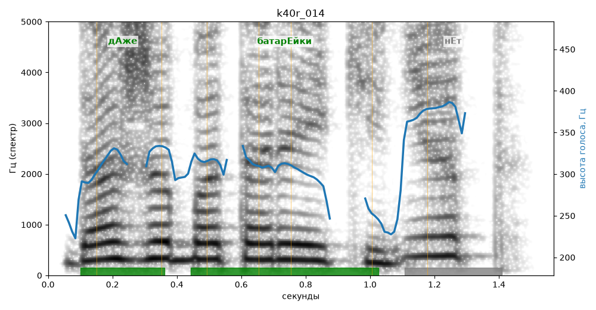

# k40r_014

Эталон: Даже батарейки нет?
Распознано: Даже батарейки нет.
Слова: все совпали

## Ударения
(где нужно: ruaccent)

| слово | нужно | у голоса | |
|---|---|---|---|
| даже | дАже | дАже | ✓ |
| батарейки | батарЕйки | батарЕйки | ✓ |

## Интонация
- ✓ «даже батарейки нет?» — вопросительный подъём на слове «нет»
- Диапазон голоса 8.5 полутонов (живо), средняя высота 312 Гц

## Паузы и темп
- паузы на своих местах
- Темп 5.4 слога/с (нормально)

_Синяя линия — высота голоса. Над словами заглавная буква — где ударение должно быть; красным — голос поставил не туда (уверенно), оранжевым — возможно._
