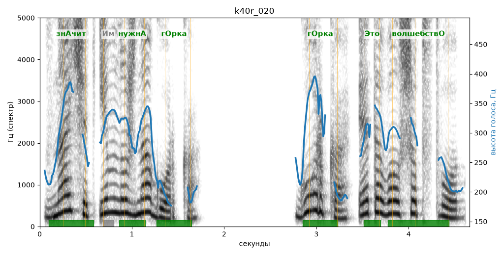

# k40r_020

Эталон: Значит, им нужна горка. Горка — это волшебство!
Распознано: Значит им нужна горка. Горка – это волшебство.
Слова: все совпали

## Ударения
(где нужно: ruaccent)

| слово | нужно | у голоса | |
|---|---|---|---|
| значит | знАчит | знАчит | ✓ |
| нужна | нужнА | нужнА | ✓ |
| горка | гОрка | гОрка | ✓ |
| горка | гОрка | гОрка | ✓ |
| это | Это | Это | ✓ |
| волшебство | волшебствО | волшебствО | ✓ |

## Интонация
- ✓ «значит им нужна горка.» — конец фразы понижается — звучит законченно
- ✓ «горка это волшебство!» — выделено слово «горка» (+2.9 пт)
- Диапазон голоса 11.7 полутонов (живо), средняя высота 292 Гц

## Паузы и темп
- паузы на своих местах
- Темп 4.9 слога/с (нормально)

_Синяя линия — высота голоса. Над словами заглавная буква — где ударение должно быть; красным — голос поставил не туда (уверенно), оранжевым — возможно._
