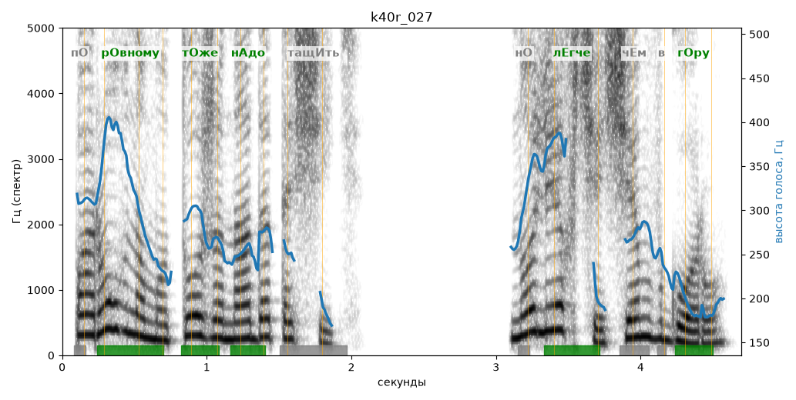

# k40r_027

Эталон: По ровному тоже надо тащить. Но легче, чем в гору.
Распознано: Поровному тоже надо тасить. Но легче чем в гору.
Расхождения в словах: «по ровному» → «поровному»; «тащить» → «тасить»

## Ударения
(где нужно: ruaccent)

| слово | нужно | у голоса | |
|---|---|---|---|
| ровному | рОвному | рОвному | ✓ |
| тоже | тОже | тОже | ✓ |
| надо | нАдо | нАдо | ✓ |
| тащить | тащИть | тАщить | ? не разобрать |
| легче | лЕгче | лЕгче | ✓ |
| гору | гОру | гОру | ✓ |

## Интонация
- ✓ «по ровному тоже надо тащить.» — конец фразы понижается — звучит законченно
- ✓ «но легче чем в гору.» — конец фразы понижается — звучит законченно
- Диапазон голоса 13.1 полутонов (живо), средняя высота 264 Гц

## Паузы и темп
- паузы на своих местах
- Темп 5.3 слога/с (нормально)

_Синяя линия — высота голоса. Над словами заглавная буква — где ударение должно быть; красным — голос поставил не туда (уверенно), оранжевым — возможно._
