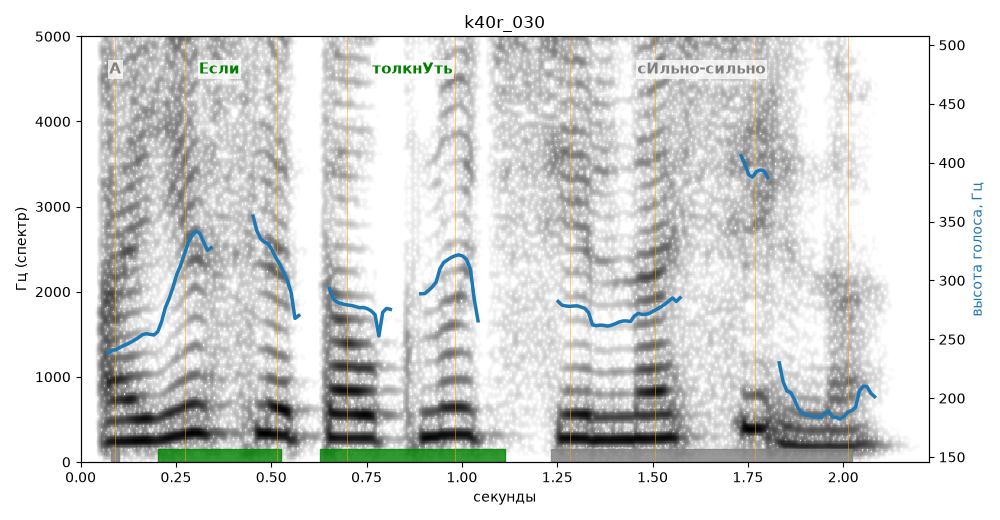

# k40r_030

Эталон: А если толкнуть сильно-сильно?
Распознано: А если толкнуть сильно сильно?
Расхождения в словах: «сильно-сильно» → «сильно сильно»

## Ударения
(где нужно: ruaccent)

| слово | нужно | у голоса | |
|---|---|---|---|
| если | Если | Если | ✓ |
| толкнуть | толкнУть | толкнУть | ✓ |
| сильно-сильно | сИльно-сильно | сильно-сИльно | ? не разобрать |

## Интонация
- ✗ «а если толкнуть сильно-сильно?» — нет вопросительного подъёма (самое высокое место — «если», в начале) — звучит как утверждение
- Диапазон голоса 12.8 полутонов (живо), средняя высота 276 Гц

## Паузы и темп
- паузы на своих местах
- Темп 4.6 слога/с (нормально)

_Синяя линия — высота голоса. Над словами заглавная буква — где ударение должно быть; красным — голос поставил не туда (уверенно), оранжевым — возможно._
