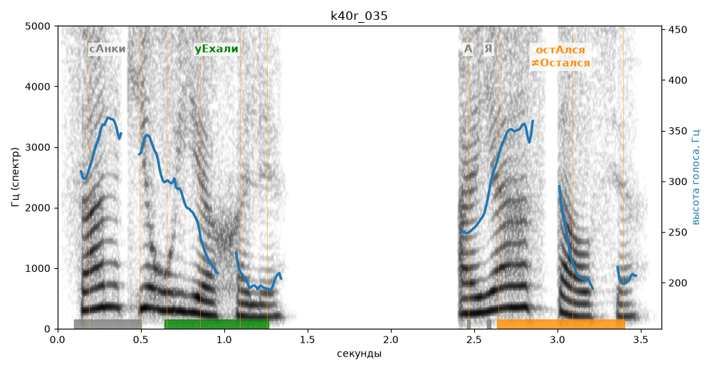

# k40r_035

Эталон: Санки уехали. А я остался.
Распознано: Санки уехали, а я остался.
Слова: все совпали

## Ударения
(где нужно: ruaccent)

| слово | нужно | у голоса | |
|---|---|---|---|
| санки | сАнки | санкИ | ? не разобрать |
| уехали | уЕхали | уЕхали | ✓ |
| остался | остАлся | Остался | ✗? возможно — послушать |

## Интонация
- ✓ «санки уехали.» — конец фразы понижается — звучит законченно
- ✓ «а я остался.» — конец фразы понижается — звучит законченно
- Диапазон голоса 10.4 полутонов (живо), средняя высота 269 Гц

## Паузы и темп
- паузы на своих местах
- Темп 4.7 слога/с (нормально)

_Синяя линия — высота голоса. Над словами заглавная буква — где ударение должно быть; красным — голос поставил не туда (уверенно), оранжевым — возможно._
