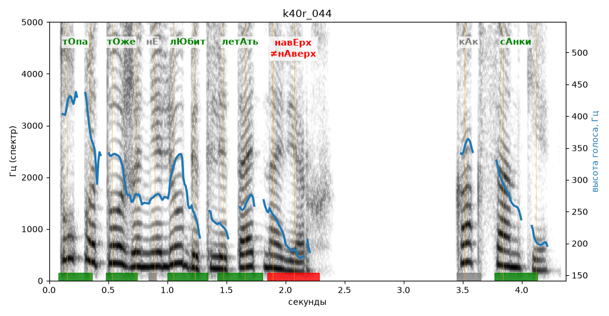

# k40r_044

Эталон: Топа тоже не любит летать наверх. Как санки!
Распознано: Тупо тоже не любит летать наверх. Как санки?
Расхождения в словах: «топа» → «тупо»

## Ударения
(где нужно: ruaccent)

| слово | нужно | у голоса | |
|---|---|---|---|
| топа | тОпа | тОпа | ✓ |
| тоже | тОже | тОже | ✓ |
| любит | лЮбит | лЮбит | ✓ |
| летать | летАть | летАть | ✓ |
| наверх | навЕрх | нАверх | ✗ ОШИБКА |
| санки | сАнки | сАнки | ✓ |

## Интонация
- ✓ «топа тоже не любит летать наверх.» — конец фразы понижается — звучит законченно
- ✓ «как санки!» — выделено слово «как» (+3.6 пт)
- Диапазон голоса 13.4 полутонов (живо), средняя высота 269 Гц

## Паузы и темп
- паузы на своих местах
- Темп 4.8 слога/с (нормально)

_Синяя линия — высота голоса. Над словами заглавная буква — где ударение должно быть; красным — голос поставил не туда (уверенно), оранжевым — возможно._
