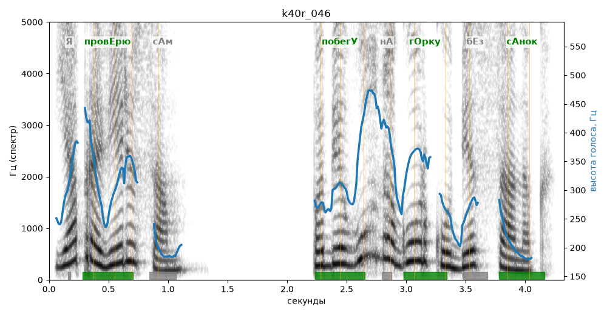

# k40r_046

Эталон: Я проверю сам. Побегу на горку без санок!
Распознано: Я проверю сам. Побегу на горку без санок.
Слова: все совпали

## Ударения
(где нужно: ruaccent)

| слово | нужно | у голоса | |
|---|---|---|---|
| проверю | провЕрю | провЕрю | ✓ |
| побегу | побегУ | побегУ | ✓ |
| горку | гОрку | гОрку | ✓ |
| санок | сАнок | сАнок | ✓ |

## Интонация
- ✓ «я проверю сам.» — конец фразы понижается — звучит законченно
- ✓ «побегу на горку без санок!» — выделено слово «побегу» (+8.5 пт)
- Диапазон голоса 15.0 полутонов (живо), средняя высота 285 Гц

## Паузы и темп
- паузы на своих местах
- Темп 4.6 слога/с (нормально)

_Синяя линия — высота голоса. Над словами заглавная буква — где ударение должно быть; красным — голос поставил не туда (уверенно), оранжевым — возможно._
