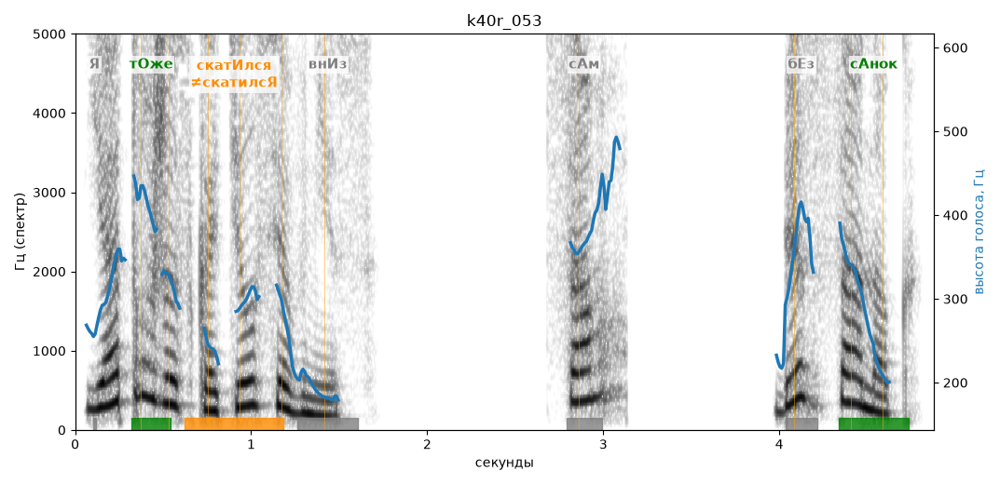

# k40r_053

Эталон: Я тоже скатился вниз. Сам! Без санок!
Распознано: Я тоже скатился вниз. Сам без санок.
Слова: все совпали

## Ударения
(где нужно: ruaccent)

| слово | нужно | у голоса | |
|---|---|---|---|
| тоже | тОже | тОже | ✓ |
| скатился | скатИлся | скатилсЯ | ✗? возможно — послушать |
| санок | сАнок | сАнок | ✓ |

## Интонация
- ✓ «я тоже скатился вниз.» — конец фразы понижается — звучит законченно
- ✗ «без санок!» — восклицание звучит ровно, без эмоции
- Диапазон голоса 14.9 полутонов (живо), средняя высота 310 Гц

## Паузы и темп
- паузы на своих местах
- Темп 4.5 слога/с (нормально)

_Синяя линия — высота голоса. Над словами заглавная буква — где ударение должно быть; красным — голос поставил не туда (уверенно), оранжевым — возможно._
