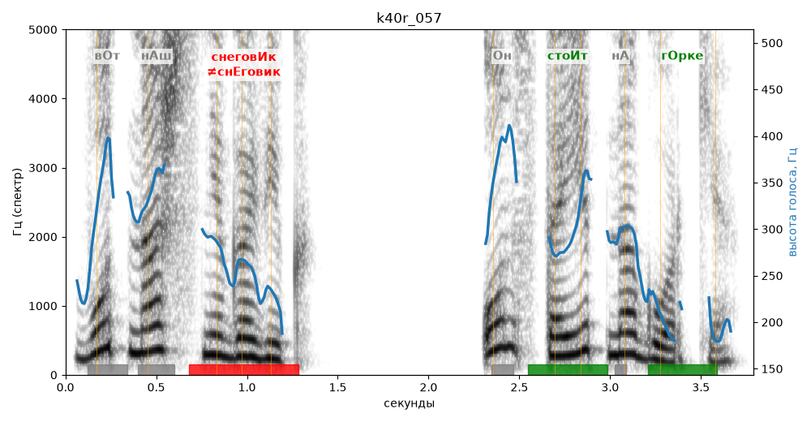

# k40r_057

Эталон: Вот наш снеговик! Он стоит на горке.
Распознано: Вот наш снеговик. Он стоит на горке.
Слова: все совпали

## Ударения
(где нужно: ruaccent)

| слово | нужно | у голоса | |
|---|---|---|---|
| снеговик | снеговИк | снЕговик | ✗ ОШИБКА |
| стоит | стоИт | стоИт | ✓ |
| горке | гОрке | гОрке | ✓ |

## Интонация
- ✓ «вот наш снеговик!» — выделено слово «наш» (+2.6 пт)
- ✓ «он стоит на горке.» — конец фразы понижается — звучит законченно
- Диапазон голоса 12.9 полутонов (живо), средняя высота 283 Гц

## Паузы и темп
- паузы на своих местах
- Темп 4.6 слога/с (нормально)

_Синяя линия — высота голоса. Над словами заглавная буква — где ударение должно быть; красным — голос поставил не туда (уверенно), оранжевым — возможно._
