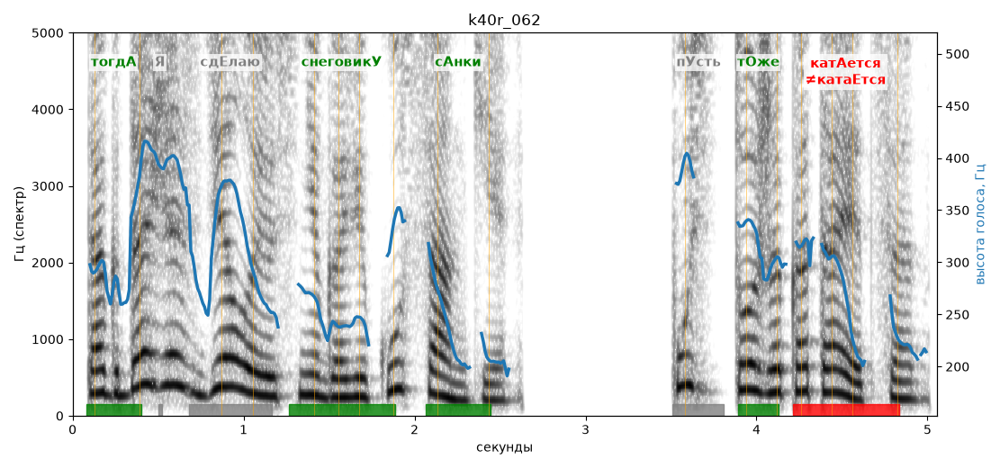

# k40r_062

Эталон: Тогда я сделаю снеговику санки! Пусть тоже катается!
Распознано: Тогда я сделаю снеговику санки. Пусть тоже катается.
Слова: все совпали

## Ударения
(где нужно: ruaccent)

| слово | нужно | у голоса | |
|---|---|---|---|
| тогда | тогдА | тогдА | ✓ |
| сделаю | сдЕлаю | — | ? |
| снеговику | снеговикУ | снеговикУ | ✓ |
| санки | сАнки | сАнки | ✓ |
| тоже | тОже | тОже | ✓ |
| катается | катАется | катаЕтся | ✗ ОШИБКА |

## Интонация
- ✓ «тогда я сделаю снеговику санки!» — выделено слово «тогда» (+5.4 пт)
- ✓ «пусть тоже катается!» — выделено слово «пусть» (+4.2 пт)
- Диапазон голоса 11.6 полутонов (живо), средняя высота 284 Гц

## Паузы и темп
- паузы на своих местах
- Темп 5.1 слога/с (нормально)

_Синяя линия — высота голоса. Над словами заглавная буква — где ударение должно быть; красным — голос поставил не туда (уверенно), оранжевым — возможно._
